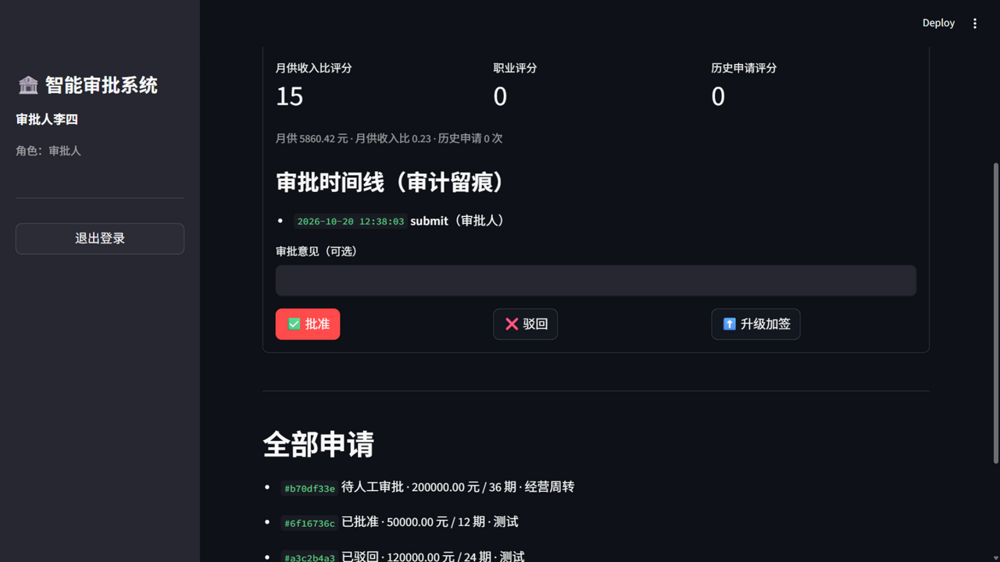
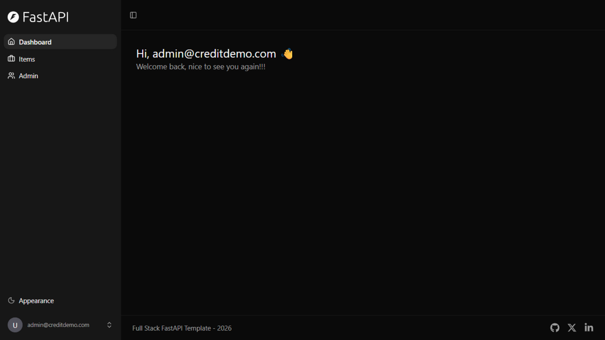
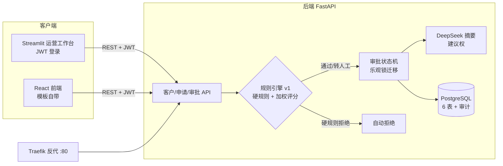
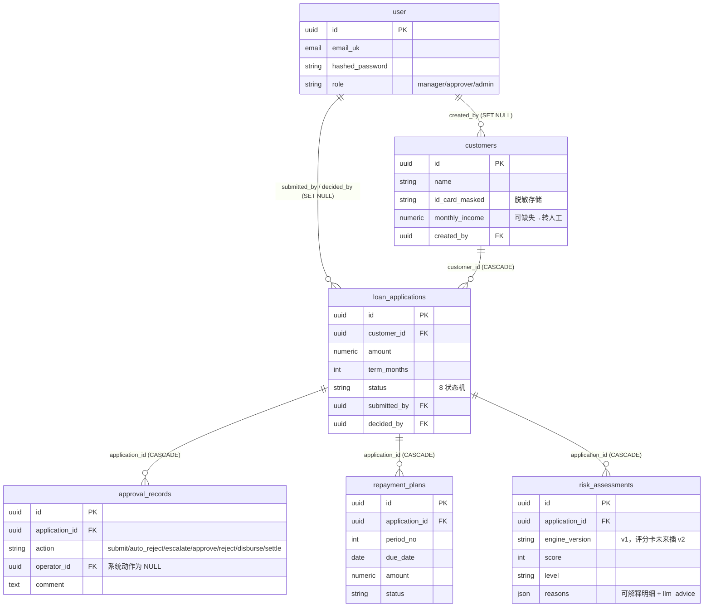
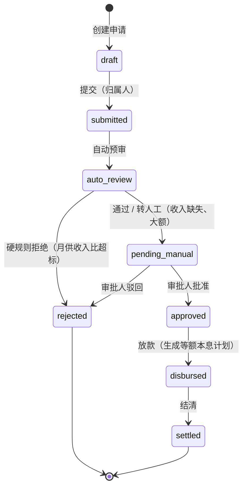

# 智能审批管理系统（Intelligent Approval Management System）

> 多角色审批全流程：客户建档 → 贷款申请 → 规则引擎自动预审 → 人工审批（批准/驳回/升级加签）→ 放款与还款计划 → 结清，全程审计留痕，LLM 生成审批意见摘要（建议权与决定权分离）。

🔗 **在线演示**：<http://120.55.68.142> （演示账号：`demo@creditdemo.com` / `Demo@2026`，角色：审批人，可查看待审列表与风险详情）

| 工作台 · 规则引擎可解释评分 | 线上生产环境 |
| --- | --- |
|  |  |

> **声明**：本仓库基于 [full-stack-fastapi-template](https://github.com/fastapi/full-stack-fastapi-template)（MIT License）构建。数据模型、审批状态机、规则引擎、LLM 模块、Streamlit 工作台与部署编排为原创改造；对模板自带的若干代码做了安全加固（见提交历史）。本项目仅为技术学习与求职演示用途，不构成任何真实金融业务。

## 功能亮点

- **可解释规则引擎 v1**（`app/services/rule_engine.py`）：硬规则（月供收入比 > 50% 自动拒、收入缺失转人工、大额升级加签）+ 三维加权评分（月供收入比/职业/历史申请），每个判定输出结构化 `reasons_json`——"为什么"可审计。全部阈值显式配置，接口化设计，未来评分卡模型以 `engine_version=v2` 平替接入
- **8 状态审批状态机 + 乐观锁**：draft → submitted → auto_review → pending_manual / rejected → approved → disbursed → settled；状态迁移用单条 `UPDATE ... WHERE status = 期望值` 原子完成，两个审批人并发决策只有一个能成功
- **审计留痕**：`approval_records` 独立成表，记录 submit/auto_reject/escalate/approve/reject/disburse/settle 全链路；系统动作 operator 为空、人工动作落到人，用户删除采用 `SET NULL` 保留审计记录
- **建议权与决定权分离**：DeepSeek 生成的审批意见摘要仅存入 `reasons.llm_advice` 供审批人参考，无 API Key 时自动降级、不影响主流程
- **数据脱敏**：证件号入库即掩码（3301\*\*\*234），接口层完成
- **测试**：78 个 pytest 用例，覆盖率 91%；测试运行在独立数据库，不污染业务数据

## 架构



## 数据模型（ER 图）



## 审批状态机



## 技术栈

FastAPI · SQLModel · PostgreSQL 18 · Alembic · Docker Compose · Traefik · pytest（78 用例/91%）· Streamlit · DeepSeek API · Python 3.14

## 快速启动（本地开发）

```bash
git clone <your-repo-url> credit-approval-system && cd credit-approval-system
cp .env.example .env          # 修改 SECRET_KEY / POSTGRES_PASSWORD / FIRST_SUPERUSER
docker compose up -d --build proxy db backend   # 首次构建约 10 分钟
docker compose exec backend bash scripts/prestart.sh   # 迁移 + 超管初始化
# 前端已构建进后端镜像，直接访问 http://localhost:8000
# Swagger: http://localhost:8000/docs
```

运营工作台（可选，宿主机运行）：

```bash
pip install streamlit requests
set CREDIT_API_BASE=http://localhost:8000/api/v1   # PowerShell；Git Bash 用 export
streamlit run workbench/app.py
```

## 测试

```bash
# 独立测试库，不影响业务数据
docker exec -it <backend-container> alembic upgrade head   # 先对测试库执行迁移（见 CI 脚本）
docker compose run --rm backend bash scripts/tests-start.sh
```

## 部署（裸 IP 云服务器，2核2G 即可）

```bash
# 服务器：安装 docker.io + docker-compose-v2，配置镜像加速与 2G swap（见提交历史中的部署实践）
# 代码：git archive 导出后 scp，或直接 clone 本仓库
cp compose.server.yml 已随仓库提供
# .env 增加：DOMAIN=<服务器公网IP>
docker compose -f compose.yml -f compose.server.yml up -d --build
```

带宽受限的机器可离线交付镜像：本地 `docker save backend:latest postgres:18 traefik:v3.7 | gzip` → `scp` → 服务器 `docker load`（入方向不限速，实测 970MB 约 19 分钟）。

## 项目结构

```
backend/app/
├── api/routes/customers.py      # 客户建档（证件号脱敏）
├── api/routes/applications.py   # 申请/审批/放款/结清 + 状态机 + 乐观锁
├── services/rule_engine.py      # 规则引擎 v1（可解释）
├── services/llm.py              # DeepSeek 审批摘要（可降级）
├── models.py                    # 6 表 + role + 全部 Schema
└── alembic/versions/            # 迁移（含业务表迁移）
tests/api/routes/test_credit.py  # 20 个业务用例
workbench/app.py                 # Streamlit 运营工作台
compose.server.yml               # 裸 IP 生产部署编排
```

## 路线图

- [ ] 评分卡模型（scorecardpy）作为 `engine_version=v2` 插入，规则接口不变
- [ ] RAG 知识库接入审批政策问答
- [ ] 域名 + HTTPS（Let's Encrypt，compose.deploy.yml 已支持）
